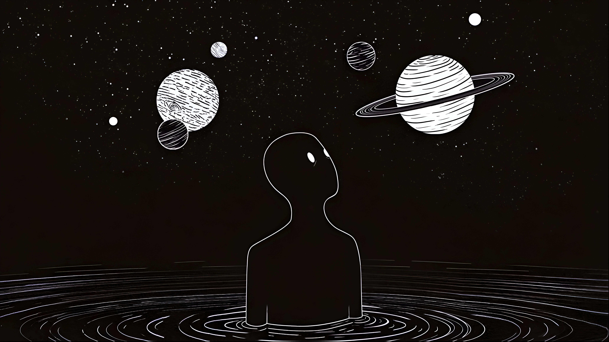

<h1 align="center">
   Hi, I'm (Matthew) Mahdi
</h1>

I'm a `full-stack` and `C++` developer with a decent amount of experience in the industry. Creating open-source apps is one of my favorite hobbies and I'm open to collaborate with everyone in the same field.

<h2 align="center">
   My Skill Set
</h2>

<table align="center">
   <tr>
      <th>Desktop</th>
      <td>C++</td>
      <td>ImGui</td>
      <td>CMake</td>
   </tr>
</table>
 

<table>
   <tr>
      <th>Web</th>
      <td>HTML</td>
      <td>JavaScript</td>
      <td>CSS</td>
      <td>React</td>
      <td>Next.js</td>
      <td>Node.js</td>
      <td>MongoDB</td>
      <td>Node.js</td>
      <td>Express.js</td>
   </tr>
</table>
 

<table>
   <tr>
      <th>Others</th>
      <td>Figma - Proficient</td>
      <td>PhotoShop - Apprentice</td>
      <td>Illustrator - Novice</td>
      <td>Linux</td>
      <td>Git</td>
      <td>GitHub</td>
   </tr>
</table>

 

<h2 align= "center">Social Media</h2>

<table align="center">
   <tr>
      <td align="center">
         <a href="https://www.linkedin.com/in/mahdi-sartipzadeh/" >
            
            
 linkedin 

         </a>
      </td>
        <td align="center">
         <a href="https://www.instagram.com/sgt.matthew_/">
            
            
 Instagram 

         </a>
      </td>
      <td align="center">
         <a href="#">
            
            
 YouTube 

         </a>
      </td>
   </tr>
</table>
